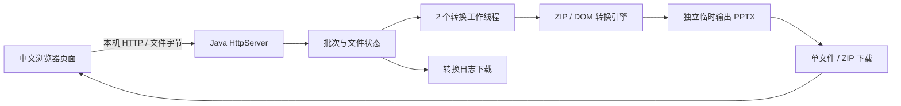

# 架构与实现

目标是保留原始 PPTX 的对象数据，使用最少必要改动完成页面扩展，而不是通过渲染后重建演示文稿。

## 模块与接口

- `PptxConverter.convert(input, output, IntConsumer)`：同步转换一个文件，返回尺寸、平移计数、字体计数和警告。任何失败抛出异常，由调用者隔离。
- `App`：仅绑定 `127.0.0.1`，维护有限数量批次及独立存储目录；HTTP 与转换线程分开。页面通过轮询状态展示进度。
- 原生 HTML/CSS/JS：`File` 二进制请求，无需 multipart 库；页面渲染使用 `textContent`，不拼接用户文件名为 HTML。所有静态资源本地提供。

| 接口 | 方法 | 行为 |
| --- | --- | --- |
| `/api/batches` | POST | 创建批次，返回 UUID |
| `/api/batches/{id}/files?name=...` | POST | 流式写入输入并排队，接受原始二进制内容 |
| `/api/batches/{id}` | GET | 文件状态、进度、尺寸、警告、错误 |
| `/api/batches/{id}/files/{fileId}/download` | GET | 下载转换结果 |
| `/api/batches/{id}/download` | GET | 下载成功结果与日志的 ZIP |
| `/api/batches/{id}/log` | GET | 下载 UTF-8 日志 |
| `/api/batches/{id}` | DELETE | 仅完成后清理批次 |

API 要求 `X-App-Token`；令牌仅存在当前进程和由其提供的页面。Host 必须为本进程的回环地址及端口，Origin 若存在必须为自身来源。不提供局域网访问模式。

## 转换流程

1. 拒绝覆盖原文件或已有输出。只读打开 ZIP，检查重复/非法路径、签名和资源上限。
2. 安全 XML 解析 `presentation.xml`，禁用 DTD、外部实体和外部 schema；读取正数宽高，拒绝 Strict 命名空间。
3. 4:3 时改变 `p:sldSz/@cx` 和 `@type`；否则保持尺寸并提示。
4. 对 PPT 内 XML 调整中英文字体：中文字符使用 SimHei，中英文混排按字符分成独立文本 run，复制原有样式和超链接；英文字体仅将微软雅黑换为 Arial；默认样式及主题东亚字体设为 SimHei。动态字段保留 ID。通过根元素识别幻灯片、版式和母版，不依赖文件名编号。
5. 仅遍历 `p:spTree` 的直接对象，找到对象自己的变换 `xfrm/off`。`spPr`、`grpSpPr`、`graphicFrame/xfrm` 分别处理；修改 x，保留 y 和 ext。组合对象不递归进入子形状；`mc:AlternateContent` 的各独立 Choice/Fallback 分别处理。
6. 没有显式位置的占位符继续使用已转换母版/版式的位置。无法定位的非占位对象保留并警告。
7. 修改部件序列化到同目录临时 ZIP，其他部件内容复制。ZIP 完整关闭后将临时文件移动到新输出，不使用覆盖选项。异常时删除临时文件，不留下半个输出。

## 状态与生命周期

单文件状态：`uploading → queued → converting → done / failed`。错误记录于该文件，不传播给整个批次。结果与警告先写入，再发布 volatile 状态。请求路径中的 UUID 必须在当前进程批次中，不能用于任意文件读取。

上传使用常量大小缓冲区，转换按部件处理而不是一次载入整个 PPT。XML 有独立上限。批次容量和总上传字节计数同步更新，避免并发超额。程序正常退出停止服务，等待转换线程结束并清理独立临时目录；不能结束的任务交由进程终止，并保留临时目录而不冒险与写入并发删除。

## 维护与扩展

V1.1 支持 4:3 和 13:9（约 1.4444）两个比例，各允许 0.5% 相对误差，避免把其他任意比例都当作 4:3。`FontNormalizer` 负责字体；`ConversionService` 在基础版直接调用引擎，在增强版通过可选 `OfficeProtection` / `OfficeEncryption` 先解密、再转换、最后用 Office Agile AES-128 / SHA-512 设置 3609。所有增强版成功输出均有打开密码；临时明文在成功或失败后清理。

加密适配器单独编译为 `ppt-office-encryption.jar`，通过 `--office-password` 启用；基础 JAR 不依赖 POI，基础版不携带加密库。增强版附带锁定校验的 Apache POI 及声明依赖，许可证保留在各 JAR 内。两版仍面向 Java 8，ZIP 外层也独立设置解压密码 3609。

原始动画、SmartArt、OLE、媒体和关系保留不等于 PowerPoint 全功能兼容认证。需要新增支持的场景应优先增加真实 PowerPoint 样本及 Windows 人工验收，再有选择地调整对应 XML。不要重建图表、删除扩展节点或缩放对象来规避兼容问题。

源码构建只需 JDK。便携包内的 Eclipse Temurin 运行时单独遵循其许可证（GPLv2 with Classpath Exception 及第三方 notices），保留官方运行时 `legal`、`NOTICE` 等文件。Windows jpackage 方案应选可合法再分发的 JDK，并随包保留其许可证。
